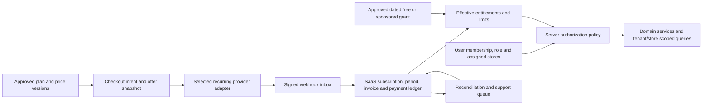

# Stockiva subscription implementation plan

**Prepared:** 14 October 2026  
**Status:** Implementation underway. The catalog, access policy, Razorpay adapter, database migrations, and checkout page are in the working tree. Paid checkout is not yet enabled.  

### Current implementation checkpoint (15 October 2026)

- `prisma migrate deploy` applied the two SaaS migrations to the `stockiva` Neon database. `prisma migrate status` reports the schema is up to date. The database has three plans, three draft versions, and six prices; no plan version is published.
- New onboarding workspaces now navigate to `/subscription/checkout` with the selected plan and interval. The page shows the selected offer and checks server-side availability.
- `GET/POST /api/subscriptions/checkout` validates the verified owner, published catalog price, matching Razorpay plan mapping, Test Mode credentials, and explicit checkout flag. POST records a pending subscription before asking Razorpay to create the provider subscription. The browser can open Razorpay Standard Checkout only when all gates pass.
- Razorpay Plans API currently rejects the configured Test Mode credentials with HTTP 401. Plan mapping and publication are therefore outstanding. `SUBSCRIPTION_TEST_CHECKOUT_ENABLED` defaults to false; webhook processing and verified activation are also outstanding. Do not enable payment collection until these are working and tested.
**Reference:** `Stockiva_Complete_Subscription_Architecture_Reference_v2.pdf` (30 pages, 13 October 2026).

## How the reference was used

The PDF is a **target design**, not evidence that its proposed tables, provider flows, policies, or controls already exist. This plan uses its phased approach, commercial access equation, lifecycle, promotions, webhook recovery, and test matrix (especially pp. 6, 8–18, 23–28). Where it differs from the application, the repository findings below take precedence. The PDF's instructions to its future implementers are design guidance; the implementation choices below follow the user's subsequent decisions.

## Decisions and current implementation

- **Provider:** Razorpay, as selected by the user. The `razorpay` server SDK is installed.
- **Plan availability:** Starter, Growth, and Business are all intended for self-service checkout. Onboarding again displays three plan cards, now sourced from the provisional catalog as previews. Its server route rejects browser-selected paid legacy plans; a preview selection cannot activate access.
- **Provisional catalog:** `src/config/subscriptions/pricing.ts` is the editable source for a *new draft version*: Starter ₹999/month or ₹9,990/year; Growth ₹2,499/month or ₹24,990/year; Business ₹4,999/month or ₹49,990/year. Prices are per organization, in integer paise, with tax marked exclusive. Annual options are billed once a year. Changing this constant requires incrementing `version` and publishing a new immutable catalog version; it never silently changes an existing subscription or Razorpay plan.
- **Built:** additive Prisma catalog/subscription/grant tables and migration; draft catalog seeder; published catalog read API; pure commercial access/role/store/quota policy; server access reader; Razorpay plan verification and subscription creation adapter. A second additive migration and a disabled-by-default signed webhook ingress durably store/deduplicate events. Policy, provider matching and signature unit tests pass.
- **Still required:** Razorpay Plans API access and matching provider plan IDs; tax and customer terms signoff; catalog publication; checkout consent snapshot; webhook inbox processing and billing ledger; verified activation; full enforcement in domain services; reconciliation, promotion, and rollout work. The schema and checkout page do not imply these are complete. Checkout and webhook intake remain disabled until these gates pass.
- **Signup email prerequisite:** `stockiva.com` is the chosen sending domain, but the Resend account currently has no verified sending domain. Add and verify `stockiva.com` in Resend, then configure `AUTH_EMAIL_FROM="Stockiva <verify@stockiva.com>"` in the application environment before testing signup with arbitrary recipients. For local testing before domain verification, `AUTH_VERIFICATION_CONSOLE_MODE=true` prints signup and resend codes in the development server terminal and, on same-origin localhost requests, in the browser console; it skips email delivery and is ignored outside development. The signup and resend routes report delivery failure instead of showing a false success, and the verification page supports retry.

## Current application baseline

| Area | Verified repository state | Implementation consequence |
| --- | --- | --- |
| Stack | Next.js 16.2 App Router, React 19, Auth.js / NextAuth v5 beta, Prisma 7/PostgreSQL, Zod 4, Playwright, Vercel configuration (`package.json`, `prisma/schema.prisma`, `vercel.json`). | Extend the existing modular application and Prisma schema. The installed Next.js guides in `node_modules/next/dist/docs/01-app/` describe Route Handlers and the `proxy.ts` convention; treat proxy as coarse routing only and authorize inside server operations. |
| Public plans | `src/config/marketing/pricing.catalog.json:4-101` still contains draft display data; the new SaaS catalog lives in `src/config/subscriptions/pricing.ts` and is seeded as a draft. | Publish the version and align marketing copy only after gateway and tax verification. All three plans will have self-service checkout. |
| Conflicting plan sources | `Organization.plan` still stores legacy **FREE/PRO/ENTERPRISE**. The onboarding cards now use the provisional SaaS catalog and label selection as a preview; its API rejects client-selected paid plans. The platform admin pricing screen remains in-memory legacy display. | Finish replacing display data with the published catalog. Never infer a paid subscription from `Organization.plan` or the onboarding preview. |
| Signup/provisioning | `src/app/api/auth/register/route.ts:114-133` creates an unassigned user and verification record. `src/app/api/onboarding/register-business/route.ts:11-17,52-100` creates an organization, main store, and owner after email verification, but accepts `plan` from the request and has no verified checkout claim. | Introduce pre-checkout email/intent and an atomic verified post-checkout claim; close the client-selected paid-plan activation path before charging. Keep a separate approved no-charge/sponsored path. |
| Identity/scope | `User` has one `orgId`, one `storeId`, one `Role`; invitations have one optional store (`prisma/schema.prisma:181-259`). Roles are SUPER_ADMIN, OWNER, ADMIN, MANAGER, STAFF (`:2013`). `src/lib/auth.ts:99-171` refreshes user authorization fields from DB into JWT sessions; `src/lib/auth.middleware.ts` provides auth helpers. Invitation tokens are generated with `Math.random()` and logged (`src/app/api/invitations/route.ts:7-14,136`). | The PDF's multi-tenant memberships, multi-store assignments, and richer action permissions require additive schema and migration; do not assume they exist. Keep `SUPER_ADMIN` distinct from merchant OWNER. Harden invite tokens when enforcing seats and assignments. |
| Access controls | `src/proxy.ts:5-59` checks public paths and session cookie presence. Some routes use role and org/store guards, e.g. `src/app/api/analytics/profitability/route.ts:12-31`, while `src/app/api/stores/route.ts:17-33` has no subscription quota check. `src/lib/rbac.ts` contains role helpers. | Build one server policy and inventory every protected route/service/query; a cookie or role check alone cannot enforce a purchased feature or limit. Protect direct API calls, exports, imports, jobs, and cross-store operations. |
| Feature foundation | `FeatureKey` contains only `WHATSAPP`, and `TenantFeature` stores one boolean per organization (`prisma/schema.prisma:1977-1993`). The marketing catalog has richer proposal/audit IDs in `src/modules/marketing/pricingCatalog.ts`; those are display data, not runtime permissions. | Reuse the existing tenant feature foundation only after deciding its role in a typed, versioned entitlement model. Map marketing IDs to stable runtime capability keys; exclude planned/unverified features. |
| Billing vs retail | `src/modules/billing/` and `SalePayment`, `PromoCode` (`prisma/schema.prisma:1470-1490`) serve **merchant POS sales**, not Stockiva SaaS charges. `src/modules/admin/services/analyticsService.ts:16-24` estimates MRR from hardcoded 0/29/99 values. | Create separate SaaS subscription invoices/payments/promotions and replace estimated MRR with defined ledger metrics; never post SaaS charges into POS sales or retail finance. |
| Provider/operations | No SaaS checkout, subscription, or payment-provider SDK appears in `package.json` or relevant `src/app/api` routes. `vercel.json` has retail/WhatsApp crons; WhatsApp has its own webhook and job patterns. `RESEND_API_KEY` and `CRON_SECRET` keys exist in local env files (values were not inspected). | Select a recurring provider after account/sandbox proof. Add provider-specific keys and a dedicated webhook secret; build durable billing inbox, processing, and reconciliation. Existing Resend HTTP usage and cron patterns can be adapted, but existing schedules do not establish billing reliability. |

### Highest priority risks before any paid launch

1. **P0 — Verified activation:** onboarding now rejects a client-supplied paid legacy plan. Build checkout/claim state and do not treat its default legacy `FREE` field as a commercial entitlement.
2. **P0 — Contradictory commercial copy:** the landing catalog still has unpublished prices and unenforced limits. Onboarding shows provisional plan previews and explains that checkout has not occurred. Publish one verified contract before showing checkout or consent.
3. **P0 — Missing entitlement coverage:** role and tenant checks exist in places, but there is no central paid-feature and quota decision across all server entry points. Start with billing/POS, stores/users, analytics, finance, exports, WhatsApp, and purchase/transfer jobs.
4. **P1 — False financial signals:** admin MRR currently uses hardcoded legacy prices, and retail `PromoCode`/`SalePayment` cannot represent SaaS discounts or collections.
5. **P1 — Scope mismatch:** a user currently belongs to one organization and one store. Moving to membership/multi-store access needs careful backfill and compatibility work.

## Target design and boundaries



Access to a resource requires an authenticated active member, an effective commercial entitlement, permission for the action, available quota, and a verified tenant/store/resource scope. Billing recovery and approved export are separately defined owner capabilities during restriction. Browser state, a redirect, `Organization.plan`, or `TenantFeature.enabled` alone cannot prove paid access. The commercial ledger is separate from merchant sales.

## Phased delivery

The phase numbers follow the PDF; each exit gate is a condition for starting dependent work or exposing it to customers. Work may be developed behind flags while gates are being reviewed.

| Phase | Work in this repository | Exit gate |
| --- | --- | --- |
| **0. Contract and risk closure** | Use Razorpay and self-service Starter/Growth/Business as decided. Review the provisional amounts in `src/config/subscriptions/pricing.ts`, then confirm matching provider plan IDs, GST/invoice owner, introductory terms, and add-ons. Inventory all route handlers, services, jobs, exports and Prisma queries by feature/action/store. Prove merchant activation and recurring mandate behavior in sandbox. Record existing tenant classification. | Verified commercial matrix, provider account proof, P0 route inventory, no ambiguous checkout copy. |
| **1. Catalog, policy and additive schema** | Add immutable `Plan`, `PlanVersion`, `PlanPrice`, `FeatureDefinition`, `PlanFeature` and typed limit values; seed only approved live capabilities. Add `Membership`, `MemberStore`, role/action policy, entitlement revision/snapshot and approved legacy-grant mapping as needed. Make one `authorize(actor, tenant, store, feature, action, resource)` boundary used by services and routes. Define stable errors, quota transactions, and read-only/recovery rules. Migrate old `User.orgId/storeId/role` reads gradually and map legacy `OrgPlan` explicitly. Initial schema, draft seed, read API and pure policy exist; transactional quotas and full route integration remain. | Policy unit/integration tests cover role, plan, tenant, store, resource, quota, revocation and recovery decisions; additive migration/backfill rehearsed. |
| **2. Billing backbone** | Add `CheckoutIntent`, `Subscription`, `SubscriptionPeriod`, SaaS `BillingInvoice`/`BillingPayment`, `WebhookEventInbox`, audit/outbox records. Implement the selected provider adapter, server-calculated checkout, exact price/version and consent snapshot, idempotency, signed raw-body webhook verification, durable receipt before 2xx, retry/backoff, provider-state fetch, and reconciliation job. Keep public webhook access narrowly scoped in `proxy.ts`. | Sandbox proves initial charge/mandate, pending/failed state, duplicate/out-of-order webhook, missed event recovery, and separate SaaS ledger. No redirect grants access. |
| **3. Claim, provisioning and comprehensive access** | Put email capture and offer review before hosted checkout. After verified provider/no-charge state, require verified email plus short-lived hashed one-use claim token; transactionally create/link user, organization, owner membership, first store, subscription and entitlement exactly once. Add browser-close and already-existing-account recovery. Replace onboarding's request-supplied plan with intent-derived plan. Apply policy to POS, products, stores, invitations, analytics, finance, WhatsApp, reports/exports, transfers and background writes; update navigation from the same effective-access DTO. Make invitations cryptographically random, hashed, one-use, email-verified, and quota-aware. | E2E: one paid intent creates one tenant; unverified/replayed/stolen claim denied; cashier/locked-plan/cross-tenant/cross-store API requests denied; existing workflow tests still pass. |
| **4. Promotions and sponsored access** | Create SaaS `Promotion`, `PromotionRedemption`, dated free-term/manual-discount benefit, and `SponsoredAccessGrant` with actor, reason, approver, end/review date and audit. Atomically reserve/finalize/void redemptions. Define one-invoice versus N-invoice versus calendar-month duration, stacking, annual-plan behavior, mandate/no-card conversion and overlap with paid subscriptions. Implement admin approval/revocation and reminders. Keep retail `PromoCode` untouched. | Concurrent redemption cap holds; 2–3 calendar months end correctly; zero-charge never becomes cash revenue; no mandate means no automatic post-free charge; sponsored expiry/revoke updates access. |
| **5. Owner/admin experience and legacy rollout** | Serve public pricing from published plan versions; show actual initial amount, tax, next amount/date and consent. Build owner subscription/payment recovery, invoices, usage/limits, change/cancel previews and staff-safe lock states. Replace the in-memory admin pricing screen and hardcoded MRR with audited publication, grants, support replay and defined SaaS financial metrics. Classify and backfill existing organizations using dated `LEGACY_MIGRATION` grants without changing POS history. Pilot internal sponsored and limited paid tenants behind flags. | Price/UI/checkout match; billing ledger reconciles with provider; legacy access preserved under explicit dated policy; rollback and support procedure ready. |
| **6. Production hardening** | Alert on stuck inbox, paid-unclaimed intent, drift, failed renewal, expiring grant and quota anomalies. Drill payment failure, delayed/missing events, refunds, chargebacks, cancellation, deployment rollback and database restore. Capacity-check provider rate limits, Neon connections, webhook throughput and scheduler reliability. Document tax/commercial operational signoffs. | Security, finance, product and QA signoff; measured reconciliation window, tested incident runbooks and staged rollout metrics. |

### Data and API contracts to design in phases 1–3

- **Schema invariants:** unique `(provider, eventId)` and external subscription/invoice/payment IDs; one effective primary subscription per organization and product scope; immutable published price/plan versions; non-overlapping or explicit grant precedence; UTC effective instants plus billing timezone; integer currency minor units; hashed one-time claim tokens; organization/store consistency; no cascade deletion of historical billing facts.
- **Public routes:** published catalog read, checkout intent creation/start/status, and selected provider webhook. Validate published `planPriceId`, interval, eligibility and offer server-side; use opaque status IDs and rate limits.
- **Merchant routes:** effective access, own subscription/invoices, change/cancel/restore, invite and store creation. Owner billing recovery remains available under restricted commercial status.
- **Platform routes:** plan publication, coupon issuance, sponsored approvals, event replay and reconciliation; require `SUPER_ADMIN`, actor/reason/correlation ID and audit. A tenant OWNER cannot use platform overrides.
- **Lifecycle:** keep provider billing state, Stockiva commercial access state, and claim/provisioning state separate. Renewals extend paid-through only after authoritative provider confirmation; cancellation, failure, grace, refunds and chargebacks follow approved policy. Downgrade preserves historical data and blocks over-limit new writes.

## Dependency and environment audit

| Need | Installed now? | Action |
| --- | --- | --- |
| Next.js/React/Auth.js, Prisma + PostgreSQL adapter/client/CLI, Zod, TypeScript | **Yes** in `package.json`. | Reuse; do not reinstall for this feature. Read installed Next.js docs before implementation because this project uses Next.js 16.2. |
| Playwright | **Yes** in `devDependencies`. | Extend existing `e2e/` suite for checkout/authorization/recovery. |
| Email transport | **Existing HTTP integration** via `RESEND_API_KEY`; no `resend` SDK. | Reuse or harden the current transport; an SDK is not required by the proposed design. Confirm verified production sender separately. |
| Recurring payment provider SDK | **Yes:** `razorpay` is installed and the server adapter is present. | No additional payment SDK is required. Configure merchant keys and verify six provider plans against the catalog before publication. |
| Durable queue/rate-limit library | **No dedicated package**, but PostgreSQL, cron routes and existing job patterns exist. | Use DB inbox/outbox and transactional counters initially; no extra npm package is mandatory. Choose external worker/scheduler infrastructure only if measured reliability demands it. |
| Provider credentials and secrets | No SaaS provider key names found in `.env` / `.env.e2e`; values were not read. | Add test/live server keys, webhook signing secret, checkout return origins and separate E2E credentials once provider is selected. Keep them out of `NEXT_PUBLIC_` except a provider's explicitly public publishable/key ID. |
| Local Node runtime | `package.json` requires **Node >=22.17 <23**. Native arm64 Node 22.22.1 is installed under `~/.nvm/versions/node/`, though the default shell still resolves an incompatible x86 Node 24. | Use `nvm use 22` for normal commands. No package installation is needed. |

### Local commands

For an `nvm`-managed shell, first select a native Node 22 matching `package.json`:

```bash
nvm install 22
nvm use 22
node -p 'process.version + " " + process.arch'  # expect v22.x.x arm64 on this Mac
```

Razorpay is already installed. After reviewing the migration and configuring a database, run `npx prisma migrate deploy` and `npm run subscription:catalog:seed` in the intended environment. The seeder creates **drafts only**. A provider account, recurring permissions, matching Razorpay plans, webhook endpoint and tax settings remain external prerequisites.

## Decisions required from product, billing and operations

| ID | Decision before launch | Proposed working default |
| --- | --- | --- |
| D-01 | Razorpay provider selected; merchant eligibility, recurring methods, webhook/sandbox support still need testing | No live checkout until provider and mandate proof. |
| D-02 | Renewal-failure grace length and allowed POS writes | Keep owner recovery/export; document exact grace and write policy. |
| D-03 | 2–3 free calendar months and automatic conversion | Auto-convert only with valid recorded consent and provider mandate; otherwise require fresh checkout. |
| D-04 | Company-owned and partner free access | Renewable 12-month sponsored grant with owner/review date. |
| D-05 | Coupon eligibility, duration and stacking | One acquisition coupon; stacking off unless explicitly approved. |
| D-06 | Upgrade proration and downgrade timing | Immediate upgrade after price/mandate consent; downgrade at renewal. |
| D-07 | Role/action/store matrix and emergency support access | Keep current role names during migration; audited platform support only. |
| D-08 | Store, seat, product and message quota units/windows | Define active-record counts and billing timezone before publishing. |
| D-09 | GST, tax-inclusive/exclusive display and SaaS invoice issuer | Finance/legal approval before collecting money. |
| D-10 | Current organizations and conflicting FREE/PRO/ENTERPRISE mapping | Classify individually; explicit legacy grants and phased migration. |

## Acceptance and rollout checklist

- **Checkout/claim:** amount or plan tampering fails; browser close, delayed webhook, same-email existing user, duplicate checkout and replayed claim converge to one correct subscription/tenant.
- **Billing:** forged webhook fails; duplicate and out-of-order events do not duplicate invoice/payment/entitlement; reconciliation repairs missed events; refund/chargeback and cancellation apply the approved access policy.
- **Promotions:** discounts, free months and sponsorship are separate from cash collection and retail promos; yearly interval does not turn three free months into three free annual invoices.
- **Authorization:** role, plan, quota and tenant/store checks hold through direct API, export, job and concurrent create paths; paid revocation takes effect on the next server operation.
- **Release:** additive migration and backfill rehearsed on non-production data; tests with sandbox provider and E2E environment; internal sponsor pilot, then limited paid cohort; compare provider invoices/collections with SaaS ledger and entitlements before broader rollout.

**Review limit:** This is a static source audit. No live database records, merchant gateway account, provider sandbox, builds, migrations or test suites were inspected/run for this plan. The PDF's illustrations and provider capability examples still need account-specific validation.
